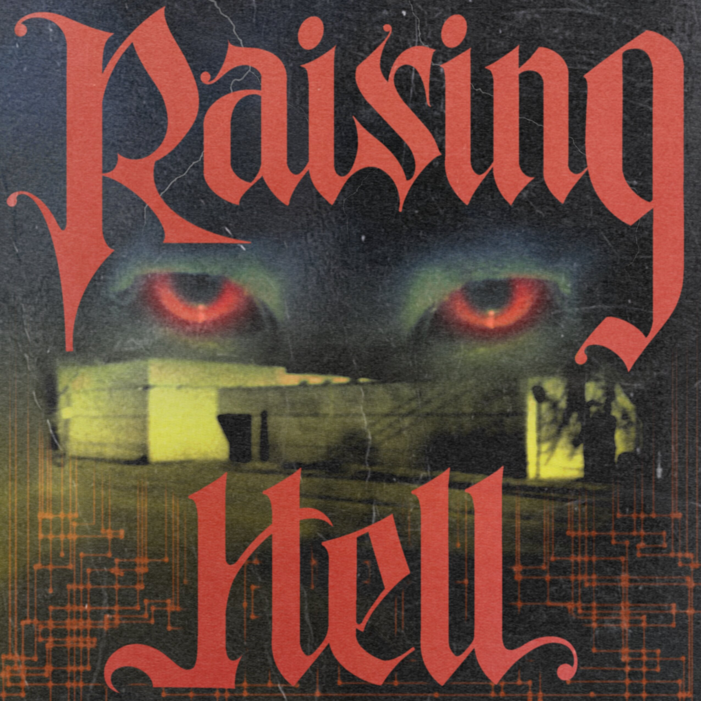

# Raising Hell - Bibliograrahy

{fig-align="center" width=30%}

> *This bibliography is a semi-comprehensive list of books, videos, transcripts, podcasts, and other related materials to the Cursed Media podcast Raising Hell by Jack LaRoche and Julian Feeld. You can gain access to this, as well as many other stellar miniseries, by subscribing at [cursedmedia.net](https://www.cursedmedia.net).*

If you're here, thank you for taking a deep interest in this subject.  It's grim, it's tangled, and it's also important.  I hope that my research over the course of the series proves valuable to those looking to further their own, and share it with others.

Importantly, I'll be updating this with more newspaper articles and transcripts. I truly wish I was as organized as somebody with a giant corkboard filled with pushpinned documents. Hopefully this will suffice.

## Books

The Mystery of the Carefully Crafted Hoax - [The Nebraska Leadership Committee, via Archive.org](https://archive.org/details/the-mystery-of-the-carefully-crafted-hoax)

The Franklin Cover-Up - [John DeCamp](https://bookshop.org/a/124482/9780963215802)

The Franklin Scandal - [Nick Bryant](https://bookshop.org/a/124482/9781936296071)

Confessions of a DC Madam - [Henry Vinson & Nick Bryant](https://bookshop.org/a/124482/9781937584306)

Why Johnny Can’t Come Home (2000) - [Noreen Gosch, via Archive.org](https://archive.org/details/why-johnny-cant-come-home_202211)

Why Johnny Can’t Come Home (2024) - [Noreen Gosch](https://www.amazon.com/WHY-JOHNNY-CANT-COME-HOME/dp/B0D1YQRK8X/142-3771530-4473468)

We Believe the Children: A Moral Panic in the 1980s - [Richard Beck](https://bookshop.org/a/124482/9781610392884)

Child Pornography: An Investigation - [Tim Tate](https://timtate.co.uk/books/)

Children For the Devil - [Tim Tate, via Archive.org](https://archive.org/details/children-for-the-devil-ritual-abuse-satanic-crime-tate-tim-z-lib.org)

The Witch-Hunt Narrative: Politics, Psychology, and the Sexual Abuse of Children - [Ross E. Chiet](https://bookshop.org/a/124482/9780190465575)

The Day Care Ritual Abuse Moral Panic - [Mary de Young](https://bookshop.org/a/124482/9780786418305)

Michelle Remembers - [Michelle Smith, Lawrence Pazder](https://archive.org/details/michelleremembe00smit)

## Videos

Who Took Johnny (2014) [Documentary](https://www.kanopy.com/en/product/who-took-johnny) (Available on most major streaming platforms)

Satan Wants You (2023) [Documentary](https://www.kanopy.com/en/product/15624782) (Available on most major streaming platforms)

Conspiracy of Silence - [Archive.org link](https://archive.org/details/SHOCKINGCoverUpConspiracyOfSilenceAbuseInBoysTown)

America’s MIA Children (MAJOR CONTENT WARNING) - [Bitchute.com link](https://www.bitchute.com/video/Y6XoGQiNArcL/)

Boys For Sale - [Youtube link](https://www.youtube.com/watch?v=2KdAY_jppPk)

Caradori Interview with Alisha Owen Excerpt - [Archive.org link](https://archive.org/details/GaryCaradoriInterviewsOfFranklinScandalVictims/GaryCaradorisInterviewOfAlishaOwen.avi) (Transcript Coming Soon)

Caradori Interview with Troy Boner Excerpt - [Archive.org link](https://archive.org/details/GaryCaradoriInterviewsOfFranklinScandalVictims/GaryCaradorisInterviewOfTroyBoner.avi) (Transcript Coming Soon)

Caradori Interview with Paul Bonacci Excerpt - [Archive.org link](https://archive.org/details/GaryCaradoriInterviewsOfFranklinScandalVictims/GaryCaradorisInterviewOfPaulBonacci.avi) (Transcript Coming Soon)

Ted Gunderson Paul Bonacci Interview - [Youtube link](https://www.youtube.com/watch?v=EvRK-IUTbfk) (Transcript Coming Soon)

Paul Bonacci Deposition - [Youtube Link](https://www.youtube.com/watch?v=QuiBsh_Yq2E) (Transcript Coming Soon)

## Podcasts

[Hunting Warhead](https://www.youtube.com/playlist?list=PLuMdLmjdG8dfnDngV7wYOLc9qNiiCOrwh)

[The Clown and the Candyman](https://podcasts.apple.com/us/podcast/the-clown-and-the-candyman/id1540131474)

[The Nick Bryant Podcast](https://www.youtube.com/@nickbryant8580)

[Commendable Commotion - Interview with Henry Vinson](https://www.youtube.com/watch?v=MiRh6NvUOFA)

[The Devil You Know](https://podcasts.apple.com/us/podcast/the-devil-you-know-with-sarah-marshall/id1844686289)

## Documents

“Newspapers Can Dish It Out, But Can They Take It?” - [David Shaw, New York Magazine](https://books.google.com/books?id=buMCAAAAMBAJ&pg=PA64&lpg=PA64#v=onepage) 11/15/1976 (Story references Michael Casey and Patty Hearst)

Nebraska Department of Social Services Records - [Archive link](https://web.archive.org/web/20210518114423/https://dhhs.ne.gov/Connections%20Newsletters/October08.pdf)

Caradori Lead List - [Archive link](https://archive.org/details/CaradoriLeadList)

Annotated Lee County Crash Report - [Archive link](https://ia600800.us.archive.org/21/items/GaryCaradori/Gary%20Caradori/leecounty1.pdf)

Grand Jury Conclusions - **Link coming soon**

Paul Bonacci Civil Case Dockets - [Archive link via George Klees](https://drive.google.com/file/d/16SFgPUXxAsCbcoBUzDMbmq77T71wLR9M/view)

Paul Bonacci Police Reports - [Archive link](https://cdn.muckrock.com/outbound_composer_attachments/rskva102/96535/Nebraska_Inmate_Details_-_Bonacci.pdf)

Troy Boner Affidavit - [Archive link](https://web.archive.org/web/20120425062236/http://franklinscandal.com/links/aff.Boner10.27.93.pdf)

Alisha Owen Gary Caradori Notes - [Archive link](https://web.archive.org/web/20100525010749/http://franklinscandal.com/links/sowens_11_7_89.pdf)

James Daniel King Gary Caradori Notes - [Archive link](https://web.archive.org/web/20101214062628/http://franklinscandal.com/links/sD_King_12_3_89.pdf)

Troy Boner Gary Caradori Notes - [Archive link](https://web.archive.org/web/20150908142707/http://franklinscandal.com/links/sBoner_11_24_89.pdf)

Alisha Owen Perjury Trial Juror Affidavit - [Archive link](https://web.archive.org/web/20101122103648/http://franklinscandal.com/links/juror51392.jpg)

Alisha Owen Perjury Trial Juror Affidavit 2 - [Archive link](https://web.archive.org/web/20101122103630/http://franklinscandal.com/links/jur.AFF.5.13.92.jpg)

Alisha Owen Perjury Trial Juror Affidavit 3 - [Archive link](https://web.archive.org/web/20101122102441/http://franklinscandal.com/links/c.aff.5.13.92.jpg)

Loran C. Schmit Affidavit - [Archive link](https://web.archive.org/web/20160412031443/http://franklinscandal.com/links/Schmit-FBI.pdf010.pdf)

Troy Boner Autopsy Report - [Link courtesy of Nick Bryant FOIA](TroyBonerAutopsy.png)

1977 Congressional Hearing on Child Exploitation - [Archive link](https://web.archive.org/web/20201125103251/https://www.ncjrs.gov/pdffiles1/Digitization/46772NCJRS.pdf)

08/18/84 Bettendorf Iowa Police Report establishing John Leonard Gosch’s assault on Noreen Gosch - [Archive link](https://archive.org/details/LJG_wifebeating/page/n1/mode/2up)

## Newspaper Articles

A vast collection of related newspaper article links - [Archive link](https://web.archive.org/web/20170703144528/http://franklincase.org/index.php?option=com_content&view=category&id=6&Itemid=14)

“Here are prominent Boys Town cases of sexual abuse, rape reported over the years” - [Lee Rood, Des Moines Register 11/01/2023](https://www.desmoinesregister.com/story/news/local/2023/11/01/a-look-at-earlier-rape-sexual-abuse-reports-in-boys-towns-history-youth-home/70790793007/)

“Alleged Homosexual Ring Found In a Raid on Apartment in Dallas” - [The New York Times 08/16/1973](https://www.nytimes.com/1973/08/16/archives/alleged-homosexual-ring-found-in-a-raid-on-apartment-in-dallass.html)

“Suspect In Mass Deaths is a Puzzle to All” - [Douglas E. Kneeland, The New York Times 01/10/1979](https://www.nytimes.com/1979/01/10/archives/suspect-in-mass-deaths-is-puzzle-to-all-affable-driven-businessman.html)

“Chicago Police Called Lax in Mass Slaying Case” - [Rob Warden, Washington Post 12/24/1978](https://www.washingtonpost.com/archive/politics/1978/12/24/chicago-police-called-lax-in-mass-slaying-case-chicago-police-accused-of-laxity-in-gacy-case/684188e1-b4ad-4900-b13a-13b50e3e54f2/ )
