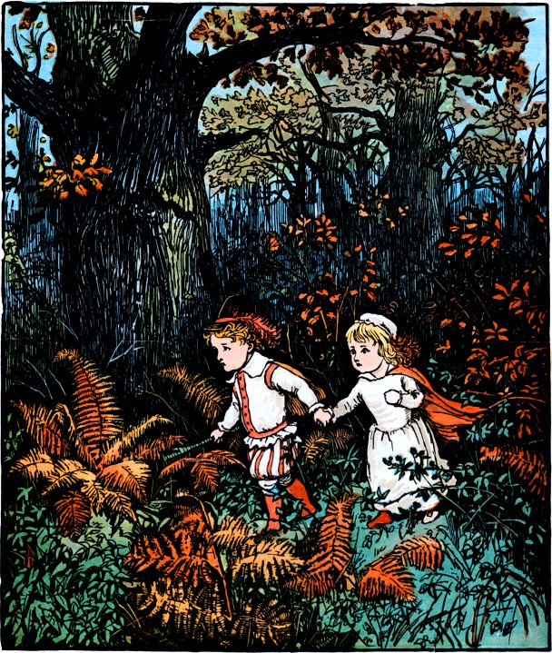

# My Mini Medieval Green Aliens Bibliography

{fig-align="center" width=50%}

**The Green Children of Woolpit: Chronicles, Fairies, and Facts in Medieval England**
[John Clark](https://bookshop.org/a/124482/9781804132395)

**Children From the Sky: A Speculative Interpretation of a Medieval Mystery – The Green Children of Woolpit**
[Duncan Lunan](https://bookshop.org/a/124482/9781908097057)

**Jonathan Strange and Mr. Norrell**
[Susanna Clarke](https://bookshop.org/a/124482/9781635576726)

[**Higherside Chats Interview with Duncan Lunan**](https://www.thehighersidechats.com/duncan-lunan-the-green-children-of-woolpit-medieval-abductions-elite-families/)