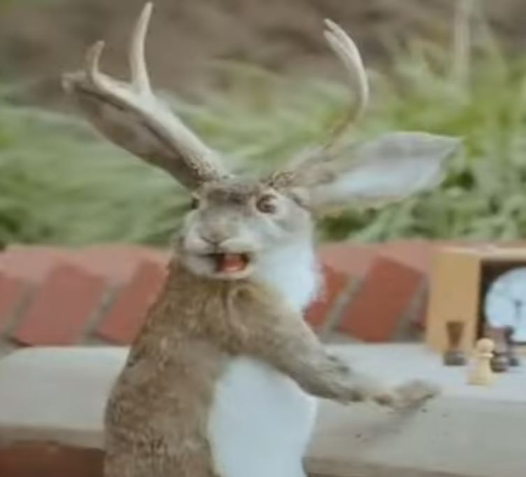

{fig-align="center" width=50%}

[**Lunchables Jackalope Commercial**](https://www.youtube.com/watch?v=pNVT4PtMQkw)

[**The Mouse and the Motorcycle**](https://www.youtube.com/watch?v=GwkKgickwkU)

[**America's Funniest People - Jack Ching Bada Bing**](https://www.youtube.com/watch?v=By9sHP1MWVk)

[**THE JACKALOPE CONSPIRACY**](https://web.archive.org/web/20010630011627/https://www.sudftw.com/jackcon.htm)

**Mythical Creatures of the North Country**
Walker D. Wyman (Out of print and unavailable online)

**Fearsome Critters of the Lumberwoods**
[William Thomas Cox](https://archive.org/details/fearsomecreatur00coxgoog)

**On the Trail of the Jackalope: How a Legend Captured the World's Imagination and Helped Us Cure Cancer**
[Michael P. Branch](https://bookshop.org/a/124482/9781639363834)

**Great North Museum - The Struggle with the Quarry**
[John Hancock](https://www.northeastmuseums.org.uk/greatnorthmuseum/whats-on/natural-northumbria)

**Stoned Fox**
[Adele Morse](https://www.adelemorse.com/stoned-fox.html)

**Rasselbock (2025)**
[Sarina Brewer](https://www.sarina-brewer.com/current-work/taxidermy-art-fantasy.html)

**Walter Potter's Curious World of Taxidermy**
[Pat Morris and Joanna Ebenstein](https://www.penguinrandomhouse.com/books/316201/walter-potters-curious-world-of-taxidermy-by-pat-morris/)

[**Big Fur (2019)**](https://www.youtube.com/watch?v=DOsYyRHpYHw)
